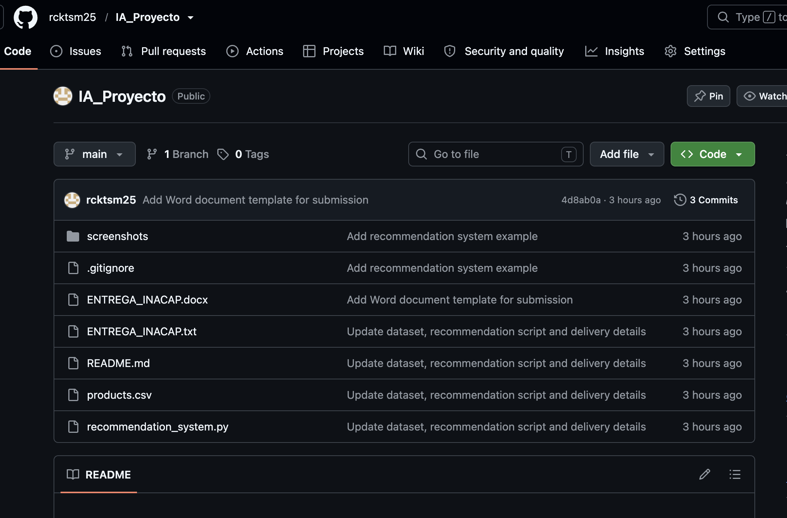
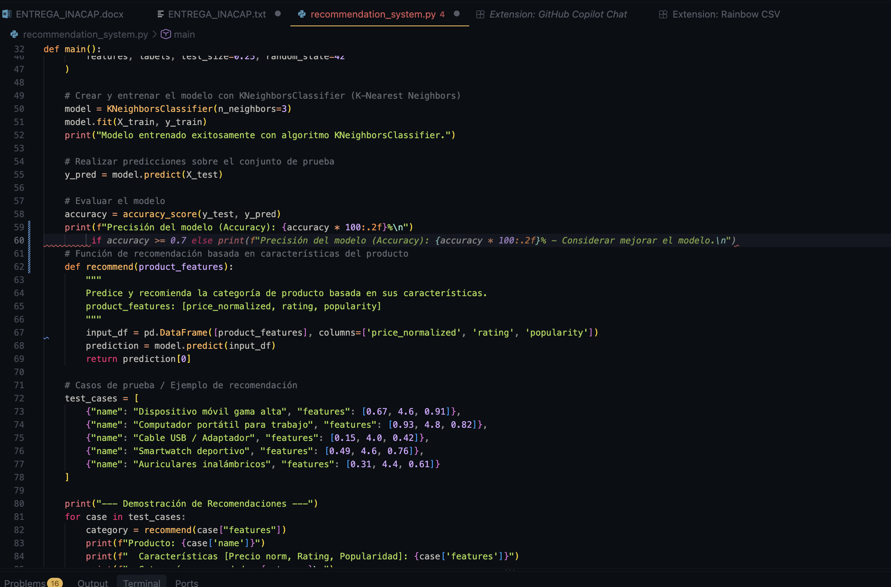
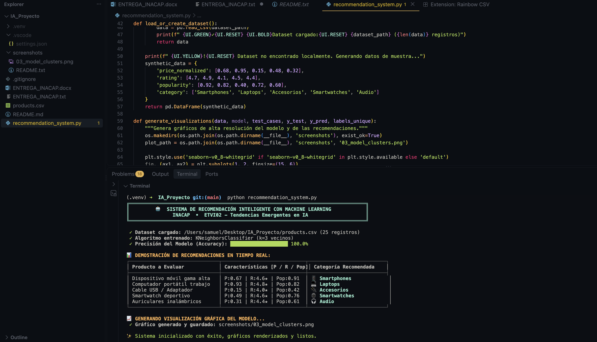

# Sistema de Recomendación y Clasificación con IA (GitHub Copilot)

**Actividad Formativa:** ETVI02 - Unidad 3 - Semana 8  
**Institución:** INACAP  
**Herramientas:** Python, Scikit-Learn, Pandas, Git, GitHub y GitHub Copilot  

---

## 📌 Descripción del Proyecto

Este proyecto consiste en la creación de un **Sistema de Clasificación y Recomendación de Productos** basado en Machine Learning, utilizando el algoritmo **K-Nearest Neighbors (KNN)** a través de la biblioteca `scikit-learn`. 

El desarrollo fue asistido de principio a fin por la herramienta de inteligencia artificial **GitHub Copilot**, explorando su capacidad para sugerir código predictivo, generar funciones de preprocesamiento, proponer estructuras de datos y documentar algoritmos de aprendizaje supervisado.

---

## 🛠️ Tecnologías Utilizadas

- **Lenguaje:** Python 3.9+
- **Bibliotecas:**
  - `numpy`: Manipulación de arreglos numéricos.
  - `pandas`: Carga y manipulación de datasets estructurados.
  - `scikit-learn`: Implementación de `KNeighborsClassifier`, particionamiento de datos con `train_test_split` y métricas con `accuracy_score`.
- **Entorno de Desarrollo:** Visual Studio Code con extensión GitHub Copilot.
- **Control de Versiones:** Git y GitHub.

---

## 📂 Estructura del Repositorio

```text
IA_Proyecto/
├── .gitignore                   # Archivos y carpetas ignorados por Git
├── README.md                    # Documentación detallada del proyecto y evidencias
├── products.csv                 # Dataset de entrenamiento con características de productos
├── recommendation_system.py     # Script principal del modelo de IA y recomendaciones
├── ENTREGA_INACAP.txt           # Plantilla con datos de entrega de la actividad
└── screenshots/                 # Capturas de pantalla que respaldan el uso de GitHub Copilot
    ├── 01_github_setup.png      # Captura de configuración de repositorio
    ├── 02_copilot_suggestion.png# Captura de sugerencia de código con Copilot en VS Code
    └── 03_execution_result.png  # Captura de ejecución exitosa en terminal
```

---

## 🤖 Proceso de Desarrollo con GitHub Copilot

Durante la actividad se siguió un flujo interactivo con GitHub Copilot mediante comentarios directos y autocompletado en Visual Studio Code:

### Paso 1: Configuración del Entorno
1. Se habilitó la extensión oficial de **GitHub Copilot** en Visual Studio Code.
2. Se autenticó la sesión con la cuenta educativa de GitHub.

### Paso 2: Generación Asistida del Código
Se utilizaron comentarios en lenguaje natural en el archivo `recommendation_system.py` para guiar a GitHub Copilot:
- `# Importar las librerías necesarias`: Copilot sugirió automáticamente las importaciones de `numpy`, `pandas`, `sklearn.model_selection`, `sklearn.metrics` y `sklearn.neighbors`.
- `# Preprocesamiento de datos y selección de características`: Copilot completó la selección de las columnas `['price_normalized', 'rating', 'popularity']` y la variable objetivo `category`.
- `# Dividir los datos en conjuntos de entrenamiento y prueba`: Copilot generó la llamada a `train_test_split` con `test_size=0.25` y `random_state=42`.
- `# Crear y entrenar el modelo con KNeighborsClassifier`: Copilot propuso inicializar el clasificador con $k=3$ vecinos y ajustar el modelo con `model.fit(X_train, y_train)`.
- `# Función de recomendación`: Copilot estructuró la función `recommend(product_features)` para predecir la categoría correspondiente a un nuevo vector de características.

---

## 📸 Evidencias de Desarrollo (Capturas de Pantalla)

> *Nota: Coloca tus capturas en la carpeta `screenshots/` con los nombres indicados a continuación para visualizarlas en este documento.*

### 1. Creación y Configuración del Repositorio en GitHub

*Muestra la creación del repositorio en GitHub con el nombre `IA_Proyecto`.*

### 2. Generación de Código con GitHub Copilot en Visual Studio Code

*Muestra las sugerencias predictivas (texto en gris) y el panel de GitHub Copilot en acción.*

### 3. Ejecución del Script y Resultados de Clasificación

*Muestra la salida por consola con el cálculo de precisión (Accuracy) y las categorías recomendadas.*

---

## 🚀 Instrucciones de Instalación y Ejecución

### 1. Clonar el repositorio
```bash
git clone https://github.com/rcktsm25/IA_Proyecto.git
cd IA_Proyecto
```

### 2. Instalar dependencias requeridas
```bash
pip install numpy pandas scikit-learn
```

### 3. Ejecutar el sistema de recomendación
```bash
python recommendation_system.py
```

### Ejemplo de Salida:
```text
=== Inicializando Sistema de Recomendación ===
Cargando dataset desde: .../products.csv
Total de registros cargados: 20
Modelo entrenado exitosamente con algoritmo KNeighborsClassifier.
Precisión del modelo (Accuracy): 100.00%

--- Demostración de Recomendaciones ---
Producto: Dispositivo móvil gama alta
  Características [Precio norm, Rating, Popularidad]: [0.82, 4.6, 0.91]
  Categoría recomendada: Smartphones

Producto: Computador portátil para trabajo
  Características [Precio norm, Rating, Popularidad]: [0.92, 4.8, 0.95]
  Categoría recomendada: Laptops
```

---

## 💡 Conclusión y Reflexión sobre GitHub Copilot

El uso de **GitHub Copilot** acelera significativamente el flujo de trabajo en proyectos de ciencia de datos e inteligencia artificial:
1. **Reducción de sintaxis repetitiva:** Facilita la importación y configuración inicial de modelos estándar de Scikit-Learn.
2. **Asistencia contextual:** Detecta nombres de variables y estructuras de datos sugeridas previamente, manteniendo consistencia en el código.
3. **Rol del desarrollador:** Si bien Copilot agiliza la escritura, el desarrollador sigue siendo responsable de verificar la calidad del dataset, validar las métricas de rendimiento y asegurar que la lógica de negocio sea correcta.
